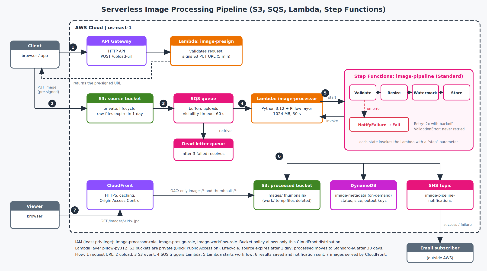
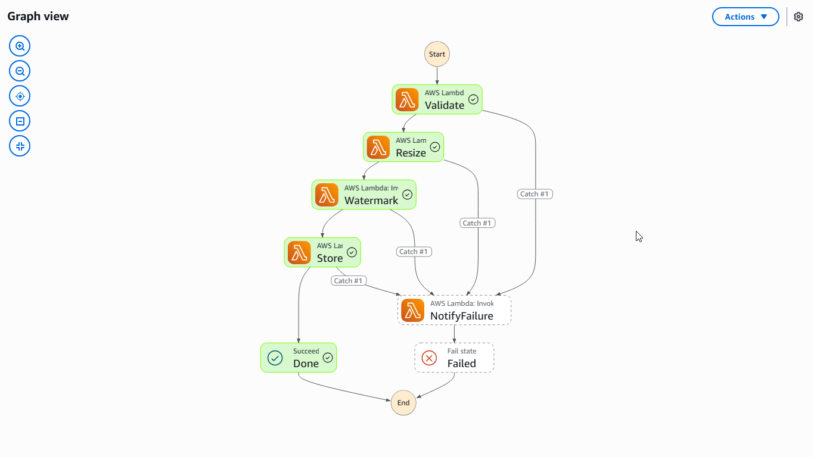
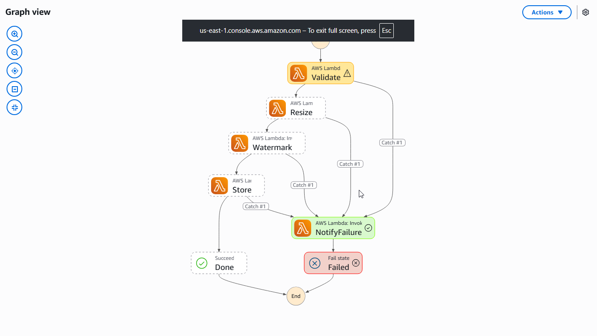

# Serverless Image Processing Pipeline on AWS

AWS Solutions Architect – Associate graduation project (Project 2).

Users upload an image with a short-lived pre-signed URL. The upload triggers an
event-driven pipeline that validates the file, resizes it, adds a watermark,
creates a thumbnail, records metadata, and sends an email notification. The
processed images are served worldwide through CloudFront from a private bucket.
Nothing in the design bills by the hour: there are no servers, NAT gateways or
load balancers.

## Architecture



**Flow**

1. The client calls `POST /upload-url` on API Gateway. A Lambda function validates the
   request and returns a pre-signed S3 `PUT` URL (valid 5 minutes).
2. The client uploads the image straight to the private **source bucket** with that URL.
   The file never passes through API Gateway or Lambda.
3. S3 sends an `ObjectCreated` event to an **SQS queue**.
4. The queue triggers the `image-processor` Lambda function.
5. The Lambda starts a **Step Functions** execution. The workflow runs
   **Validate → Resize → Watermark → Store**, invoking the Lambda once per step.
6. Results go to the **processed bucket** (`images/` and `thumbnails/`), metadata goes to
   **DynamoDB**, and an **SNS** email reports success or failure.
7. Viewers fetch images over HTTPS from **CloudFront**, which reads the private bucket
   through Origin Access Control.

## AWS services and why each was chosen

| Service | Role in the solution | Why |
|---|---|---|
| API Gateway (HTTP API) | `POST /upload-url` endpoint | Simpler and about 70% cheaper than a REST API; no REST-only feature is needed. Throttled to 2 req/s (burst 5). |
| Lambda `image-presign` | Signs the upload URL | Keeps the bucket private; the URL grants `PutObject` on one key for 5 minutes. Only three image content types are accepted and the object key is generated server-side. |
| S3 source bucket | Receives raw uploads | Private. Lifecycle rule deletes raw files after 1 day. |
| SQS + dead-letter queue | Buffers upload events | Decouples upload from processing, absorbs bursts, retries failures. After 3 failed receives a message moves to the DLQ. |
| Lambda `image-processor` + Pillow layer | Image work | Pillow is packaged as a Lambda layer built inside the Lambda Python 3.12 image so the binaries match the runtime. |
| Step Functions (Standard) | Orchestration | Visual execution history per image, per-step retries with backoff, failure handling declared in the workflow. |
| S3 processed bucket | Stores results | Private. Lifecycle moves objects to Standard-IA after 30 days. |
| DynamoDB (on-demand) | Image metadata | Single lookup by `imageId`, so one partition key is enough. No cost when idle. |
| SNS | Notifications | Publisher does not know its subscribers; email can be swapped for SMS or a webhook without code changes. |
| CloudFront + OAC | Global delivery | HTTPS, caching, and a bucket that is never public. |
| IAM | Access control | Three separate roles, each limited to named resources. |

## Design decisions worth noting

- **Two buckets, not one.** If results were written to the bucket that triggers the
  pipeline, every output would start another job (an infinite loop).
- **Permanent versus transient errors.** A file that is not a valid image is marked
  `FAILED` and reported immediately; retrying cannot fix it (`ValidationError` has
  `MaxAttempts: 0` in the workflow). Any other error is retried twice with exponential
  backoff.
- **Idempotency.** The image ID is a hash of bucket, key and S3 sequencer, and it is also
  the Step Functions execution name. SQS delivers at least once, so a duplicate message
  updates the same DynamoDB item and cannot start the work twice.
- **Work files.** The resize step leaves a temporary file under `work/` in the processed
  bucket; the watermark step reads and deletes it. The CloudFront bucket policy only
  exposes `images/*` and `thumbnails/*`, so temp files are never reachable.
- **Retries moved to Step Functions.** Once the workflow takes over, the SQS message is
  deleted as soon as the execution starts. The DLQ therefore only catches failures to
  *start* an execution; processing failures are handled by the workflow's Retry/Catch.
- **Never enlarge images.** Images smaller than 1280 px keep their size; larger ones are
  scaled down (thumbnail: 256 px).

## Security

- Both S3 buckets have Block Public Access enabled and default encryption (SSE-S3).
- The processed bucket is readable only by this CloudFront distribution (bucket policy with
  an `AWS:SourceArn` condition) and only under `images/*` and `thumbnails/*`.
- Least-privilege IAM, with no wildcard resources:
  - `image-presign-role`: `s3:PutObject` on the source bucket only.
  - `image-processor-role`: read source, write processed, read/delete `work/*`, DynamoDB
    item access on one table, publish to one topic, consume one queue, start one state machine.
  - `image-workflow-role`: invoke one Lambda function only.
- S3 may send messages to the queue only from the source bucket in this account.
- Uploads are limited by content type, signed into the URL (a mismatching `Content-Type`
  is rejected with `403`), and validated again after upload (format, size, pixel count).

## Verified behaviour

| Test | Result |
|---|---|
| Upload a photo with a pre-signed URL | Workflow `SUCCEEDED`; `images/<id>.jpg` and `thumbnails/<id>.jpg` created |
| Upload a text file named `.jpg` | Workflow ends `FAILED` (one failed execution, no retry of the bad file) |
| Request URL with `contentType: text/plain` | `400` |
| Upload with a different `Content-Type` than signed | `403` |
| Fetch an image through CloudFront twice | `x-cache: Hit from cloudfront` with an `Age` header |
| Fetch the S3 URL directly, or `/work/*`, `/deploy/*` via CloudFront | `403` |

Execution graphs:

| Success | Failure |
|---|---|
|  |  |
## Try it

```bash
# 1. Ask for an upload URL
curl -s -X POST "https://12fdcfthf4.execute-api.us-east-1.amazonaws.com/upload-url" \
  -H "Content-Type: application/json" \
  -d '{"fileName":"photo.jpg","contentType":"image/jpeg"}'

# 2. Upload the image to the returned uploadUrl (Content-Type must match)
curl -X PUT "<uploadUrl>" -H "Content-Type: image/jpeg" --data-binary @photo.jpg

# 3. After a few seconds, view the result (the key is images/<imageId>.jpg)
https://dhw66nafoy9yb.cloudfront.net/images/<imageId>.jpg
```

## Cost

Every component is pay-per-request. Within the AWS free tier this lab costs effectively
nothing; the only storage that grows is the processed bucket. Cost control choices:
HTTP API instead of REST API, on-demand DynamoDB, CloudFront price class 100, Lambda sized
at 1024 MB only where image decoding needs it, 1-day expiry on raw uploads.

## Repository layout

```
.
├── README.md
├── docs/
│   │   ├── architecture.png        solution architecture diagram
│       ├──  architecture-notes.md   step-by-step build log and decisions
│       └── execution-*.png         Step Functions execution graphsdecisions
├── lambdas/
│   ├── processor/lambda_function.py   validate / resize / watermark / store / fail
│   └── presign/lambda_function.py     pre-signed URL generator
└── infra/                      IAM policies, S3 lifecycle rules, queue policy,
                                S3 notification, state machine, CloudFront config
```

`docs/architecture-notes.md` records each build step, including the problems found while
testing and how they were fixed (for example, the processor role initially lacked read and
delete access to its `work/` files, which only showed up in a real end-to-end run).

## Limitations and what I would add for production

- **API authentication.** The upload endpoint is open (rate-limited only). Add a JWT
  authorizer such as Amazon Cognito, and AWS WAF in front of API Gateway and CloudFront.
- **Upload size limit.** A pre-signed `PUT` cannot cap file size; the pipeline rejects large
  files afterwards. A pre-signed `POST` with a `content-length-range` condition would
  enforce it at upload time.
- **Infrastructure as code.** Resources were created with the AWS CLI for learning
  purposes. CloudFormation, CDK or Terraform would make the stack repeatable.
- **Observability.** Add CloudWatch alarms on the DLQ depth and on failed executions, and
  X-Ray tracing.
- **Custom domain.** Attach a domain and an ACM certificate to CloudFront.
- **Encryption.** Use customer-managed KMS keys if key-level auditing is required.
